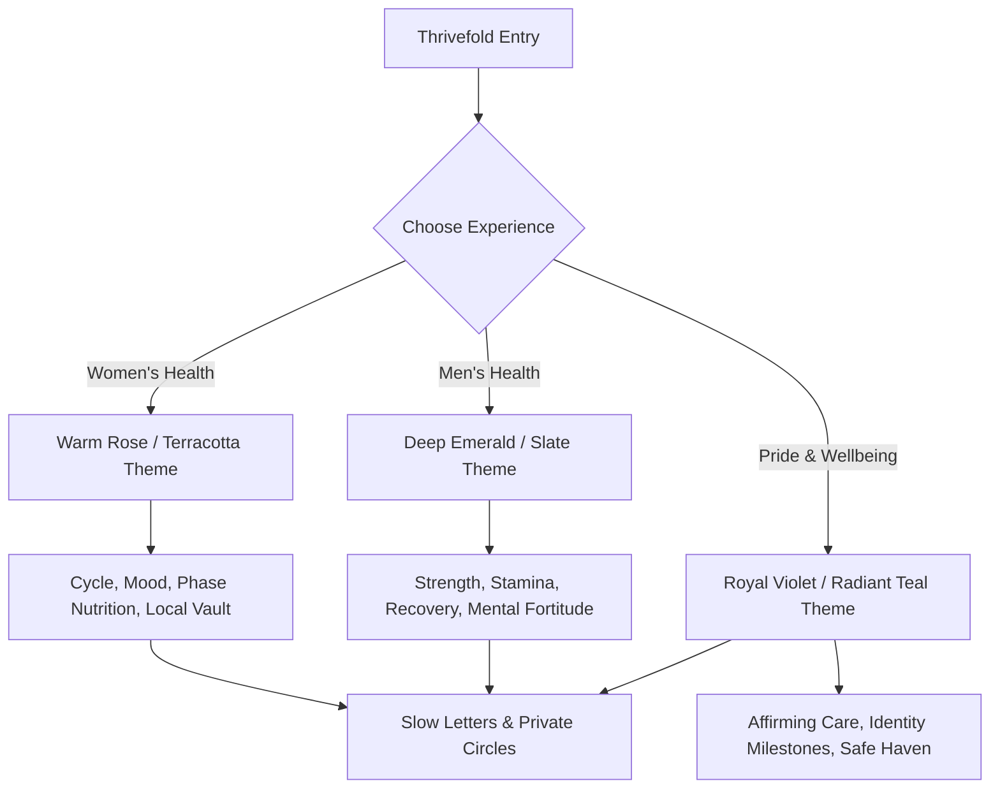

# Thrivefold — Master Product Specification & Vision

## 1. Executive Summary
Thrivefold is a next-generation health, wellbeing, and slow-correspondence ecosystem built on modern Expo React Native for iOS, Android, and Web. Inspired by the calm design language of **Setu** and the gamified sensory feedback loops of **BlinkQuest**, Thrivefold delivers an intentional, humane, and deeply private mobile experience.

### Core Philosophy
1. **Local-First & Offline Sovereign**: All daily check-ins, journal reflections, health telemetry, and AI classifiers execute on-device without cloud dependency.
2. **Three Dedicated Health Experiences**:
   - **Women's Health**: Cycle tracking, luteal/follicular phase nutrition, hormonal wellness, and reproductive autonomy.
   - **Men's Health**: Stamina, hormonal balance, mental resilience, workout telemetry, and recovery.
   - **Pride & LGBTQ+ Wellbeing**: Gender-affirming health milestones, identity-safe reflections, mental wellness, and affirming health navigators.
3. **Slow, Intentional Correspondence**:
   - Chip-only composer preventing toxic unstructured chat, phone number sharing, or harassment.
   - Pseudonymous pen-pal discovery based on shared health interests.
   - Distance-delayed letter delivery (hours to days) encouraging thoughtful, asynchronous connection.
4. **Zero-Trust Safety & Policy Engine**:
   - Strict 18+ adult age assurance requirement for all social interactions.
   - 7-day restricted correspondence trial for under-25 cohorts with a hard quota of 1 intro/day and complete isolation from community directories.
   - Founder-requested sensitive religious/cohort policies kept in explicit `REVIEW_REQUIRED` hold status.

---

## 2. Three Pillars of User Experience

### Experience A: Women's Health
- **Colorway**: Soft Peach (`#FFF8F5`), Rose Gold (`#E07A5F`), Crimson Coral (`#9B2226`).
- **Core Trackers**: Menstrual & Ovulation cycle days, follicular vs luteal nutrition recommendations, basal body temperature, pelvic floor reminders.
- **HarmonyBloom Continuity**: Complements the existing web app (`Apps/harmony-bloom`) by providing high-touch native on-device notifications, widgets, and offline persistence.

### Experience B: Men's Health
- **Colorway**: Deep Pine (`#0A1917`), Sage Slate (`#52B788`), Cool Steel (`#2D6A4F`).
- **Core Trackers**: Testosterone support habits, circadian sun exposure, VO2 max progression, daily cold recovery, prostate wellness reminders.
- **Mental Grounding**: Stoic reflection chips, accountability streaks, non-judgmental stress decompression.

### Experience C: Pride & LGBTQ+ Wellbeing
- **Colorway**: Midnight Indigo (`#120E24`), Vivid Amethyst (`#7209B7`), Horizon Cyan (`#4CC9F0`).
- **Core Trackers**: Hormone replacement therapy (HRT) schedule and dosage reminders, injection site rotation, post-operative healing markers, dysphoria support tools.
- **Safety**: Built-in quick panic lock, private alias masking, and non-identifying health terminology.

---

## 3. The Slow Correspondence Subsystem (Letter Exchange)
Thrivefold replaces instant messaging addiction with the contemplative cadence of pen-pal postal letters.

1. **Card & Chip-Only Composer**:
   - Users construct letters exclusively by selecting curated sentiment cards, health reflections, and wellness inquiries.
   - **Zero free-form text input**: Eliminates cyberbullying, unsolicited image sharing, stalking, hate speech, and spam.
   - Up to 5 chips per letter, accompanied by a collectible aesthetic digital stamp.
2. **Distance & Time-Delayed Delivery**:
   - Mathematical formula: `DeliveryHours = min(72, max(4, round(DistanceKm / 120)))`.
   - Simulates physical post traveling between geographic regions, preventing dopamine loops and instant gratification.
3. **Stamps & Stationery**:
   - Unlockable digital stamps based on health milestones, season transitions, and cultural heritage.

---

## 4. Policy Engine & Safety Architecture
- **Precedence 1**: Age Verification Gate (Under 18 strictly barred from adult social/correspondence features).
- **Precedence 2**: Recipient Mutual Blocks & Preference Filtering (Instant halt if either party blocks the other).
- **Precedence 3**: Sensitive Religious & Geographic Policies (Marked `REVIEW_REQUIRED`; never covertly enforced).
- **Precedence 4**: Under-25 Pilot Restrictions (7-day trial, 1 new intro/day max, barred from community directory).
- **Precedence 5**: Explicit User Consent (Every social and AI feature requires an intentional opt-in switch).

---

## 5. Commercial Model & Free Tier Sovereignty
- **$0 Free-For-Life Core**: Full offline health tracking, local AI insights, cycle/workout tracking, encrypted journal, and standard slow letters (3 pending slots).
- **Correspondence Plus ($4.99/mo optional)**: Expanded outbox capacity (10 pending letters), bespoke collectible art stamps, and advanced cross-device encrypted backup.
- **No Advertising, No Data Brokering**: Zero third-party ad SDKs or location trackers.
