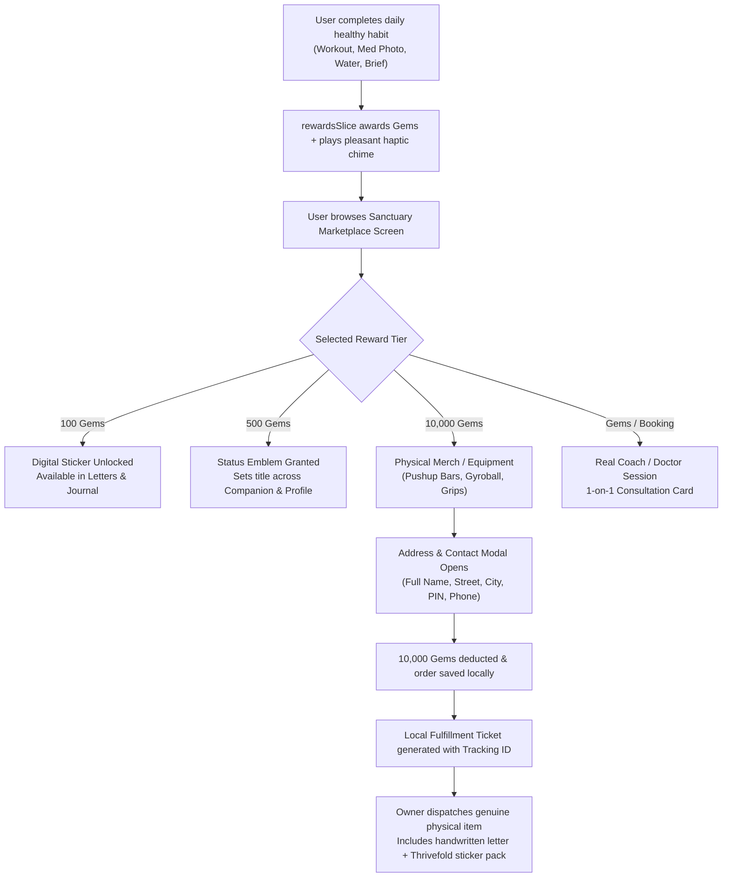

# Thrivefold — Real Rewards, Gems Economy & Multimodal Asset Specification

> **Version**: 1.0.0  
> **Status**: Approved Product & Implementation Blueprint  
> **Ecosystem**: AnvayKosh / Thrivefold  
> **Visual Identity**: Scandinavian-Japanese Wellbeing Minimalism · Pista (`#7A8A6D`), Terracotta (`#D06543`), Cream (`#FAF7F2`), Amber Gold (`#DEB05C`)

---

## 1. Executive Vision & Philosophy

Thrivefold bridges digital wellbeing habit-forming with **tangible, real-world rewards**. Unlike apps with useless gamification points or fake coins, Thrivefold's **Gems Economy** provides authentic value:
1. **Digital Badges & Custom Stickers (100 Gems)**: Enrich slow-chip letters, daily journal entries, and personal avatars.
2. **Sanctuary Status Emblems (500 – 5,000 Gems)**: Unlock respected titles and exclusive UI themes across Anvay Coach and the dock.
3. **Physical Fitness Equipment (10,000 Gems)**: Real, high-grade workout equipment (beechwood parallettes, precision gyroballs, silicone grips, stationery sets) dispatched directly to dedicated users.
4. **Professional Consultations**: Dedicated access to accredited 1-on-1 health coaches and verified telehealth clinicians.

---

## 2. The Gems Economy Architecture

### 2.1 Earning Rules (Deterministic, On-Device, Anti-Fraud)

All gem transactions are calculated deterministically on the client device, stored securely in MMKV (`rewardsSlice`), and validated against local time and habit logs to avoid duplicate exploitation.

| Action Category | Specific Habit Trigger | Gem Reward | Cooldown / Limit |
|---|---|---|---|
| **Daily Briefing** | Listen or read morning brief from local data | **+15 Gems** | Once per calendar day |
| **Workout & Somatic** | Complete 15 min pose tracker or 3,000 steps | **+30 Gems** | Max 2x per day (+60 max) |
| **Medication Verification** | Photograph pill bottle / strip via MedFlow | **+25 Gems** | Per scheduled dose window |
| **Meal Vision** | Capture and analyze meal nutrition photo | **+20 Gems** | Max 3x per day (+60 max) |
| **Hydration Milestones** | Log 8/8 glasses of water | **+15 Gems** | Once per day |
| **Voice Practice** | Complete 2+ mins of speech/vocal coaching | **+25 Gems** | Once per day |
| **BYOK Security** | Configure private on-device or BYOK API key | **+100 Gems** | One-time milestone bonus |
| **Weekly Consistency** | Maintain a 7-day uninterrupted streak | **+100 Gems** | Weekly milestone bonus |
| **Monthly Mastery** | Complete 30-day sanctuary journey | **+500 Gems** | Monthly milestone bonus |

### 2.2 Gem Top-Ups (Optional Store Packs)
For users who want to accelerate their journey or gift status tokens, optional gem packs can be made available when billing is enabled in future releases:
- **Seed Pouch (100 Gems)**
- **Bloom Satchel (500 Gems)**
- **Sanctuary Vault (2,500 Gems)**
- **Luminary Trove (10,000 Gems)**

---

## 3. The Real Reward Flow (End-to-End)



### 3.1 Physical Equipment Redemption Detail (10,000 Gems Tier)
When a user accumulates 10,000 genuine gems through consistent months of wellness practice:
1. **Redemption Sheet**: User taps "Redeem Equipment" on the item card.
2. **Shipping Capture**: An `AppBottomSheetModal` collects:
   - Full Name
   - Shipping Address & Apartment / Landmark
   - City & State / Province
   - Postal / PIN Code
   - Mobile Phone Number (for delivery courier SMS)
3. **Local Order Receipt**:
   - Order ID: `TF-ORD-<TIMESTAMP>-<RANDOM_HEX>`
   - Status: `Ordered · Preparing for Dispatch`
   - Estimated Delivery: 7–10 Business Days
4. **Manual Dispatch Process**:
   - Packaged with custom Thrivefold unboxing tissue paper.
   - Includes physical Die-Cut Vinyl Sticker Pack and a personalized handwritten welcome card from the creator.
   - Courier tracking number is updated into the user's order drawer.

---

## 4. Digital Asset Generation Prompts (AI Image Generation Specs)

### Universal Style Standard:
- **Palette**: Pista Green (`#7A8A6D`), Terracotta (`#D06543`), Cream White (`#FAF7F2`), Amber Gold (`#DEB05C`), Charcoal (`#2B1B14`).
- **Watermark**: All assets must feature a delicate, debossed geometric Thrivefold emblem ("T" root with twin sage leaf arch) watermarked in the bottom-right corner.
- **Lighting**: Soft Scandinavian diffuse daylight, subtle bevel highlights, zero harsh 3D neon artifacts.

---

### 4.1 Currency & Gem Prompts

#### Prompt G1: Single Amber Gem (Currency App Icon)
```text
A glowing isometric faceted amber-gold gem icon, emerald-cut jewel with subtle reflections of terracotta orange and pista green inside the glass, isolated on a solid #FAF7F2 cream background, soft subsurface scattering, subtle frosted bevels, discreet geometric 'T' leaf logo watermarked in bottom-right corner, modern Apple Fitness award aesthetic, 3D vector render, 8k.
```

#### Prompt G2: Pouch of 100 Gems
```text
An organic cream linen pouch tied with a soft sage-green drawstring, spilling out four glowing faceted amber crystals onto a polished limestone surface, warm morning sunbeam, minimalist luxury health aesthetic, subtle debossed Thrivefold logo watermark in corner, high resolution 3D render.
```

#### Prompt G3: Sanctuary Vault of 10,000 Gems
```text
A sleek Scandinavian natural beechwood treasure box with brass hinges slightly open, glowing intensely with warm amber-gold crystals and golden particles from inside, minimalist clean lines, warm studio lighting, small laser-engraved Thrivefold icon watermark, ultra-crisp product render.
```

---

### 4.2 Digital Stickers (100 Gems Tier)

#### Prompt S1: Zen Mountain & Sun
```text
Die-cut sticker of a rising terracotta sun peeking behind layered rolling sage-green hills and misty pine trees, Japanese woodblock print texture with modern flat vector lines, thick smooth white vinyl sticker border, isolated on pure white background, peaceful wellness illustration, micro Thrivefold leaf emblem watermark.
```

#### Prompt S2: Hydration Dewdrop
```text
Die-cut vinyl sticker of a translucent cerulean and pista green water droplet encasing a delicate blooming golden lotus petal, clean modern graphic design, smooth gloss finish with white die-cut contour border, mindfulness health badge, subtle brand watermark.
```

#### Prompt S3: Inner Resilience Oak
```text
Die-cut sticker featuring a grounded geometric oak tree with deep terracotta roots and soft pista olive foliage, stylized linework, warm earthy tones, crisp white sticker border, fitness milestone token, subtle brand watermark in corner.
```

#### Prompt S4: Mindful Tea Hearth
```text
Die-cut sticker of a rustic Japanese ceramic tea bowl in earthy terracotta glaze, a single continuous steam line spiraling upward gracefully into an infinity loop, cozy relaxation graphic, white die-cut sticker outline, isolated.
```

#### Prompt S5: Dynamic Flow Athlete
```text
Die-cut minimalist sticker showing a dynamic fluid runner silhouette composed of sweeping terracotta, sage, and gold ribbon brushstrokes, inspiring movement and agility, crisp white sticker border, modern sports motivation art.
```

---

### 4.3 Status Emblems (500 – 5,000 Gems Tier)

#### Prompt E1: Grounded Seeker (500 Gems Milestone)
```text
A circular medallion made of polished terracotta ceramic with a brushed bronze outer rim, featuring a debossed concentric labyrinth motif in the center, luxury award badge design, soft warm rim lighting, isolated on cream background, subtle engraved Thrivefold monogram watermark.
```

#### Prompt E2: Sanctuary Sentinel (2,500 Gems Milestone)
```text
A heraldic hexagonal shield emblem crafted from satin silver and pista-green enamel, centered with a glowing cut-amber gemstone, flanked by two delicate olive branch laurels, prestigious wellness milestone crest, Apple Health style badge, 3D vector render.
```

#### Prompt E3: Thrivefold Luminary (5,000 Gems Milestone)
```text
A radiant twelve-pointed sunburst medal forged in brushed champagne gold, centered with an iridescent multi-faceted amber jewel, floating delicate orbit rings around the perimeter, grand master health achievement emblem, museum lighting, subtle brand watermark.
```

---

### 4.4 Real Physical Equipment (10,000 Gems Tier)

#### Prompt P1: Solid Beechwood Pushup Parallettes
```text
High-end commercial product photograph of a pair of ergonomic pushup parallettes made from solid Scandinavian beechwood, smooth curved handles, non-slip natural Portuguese cork base pads, subtle laser-engraved Thrivefold leaf icon on the wood side, set on a honed travertine stone floor with soft linen gym towel, luxury fitness equipment photography.
```

#### Prompt P2: Precision Metal Gyroball Powerball
```text
Studio product photograph of an ergonomic matte charcoal-anodized aluminum gyro powerball, visible solid brass rotor through a high-clarity polycarbonate window, non-slip silicone grip band around the equator, sleek physical therapy tool, soft rim studio lighting, subtle laser-etched brand logo on housing.
```

#### Prompt P3: Ergonomic Hex Barbell / Dumbbell Grips
```text
A pair of thick ergonomic barbell dumbbell grips molded from durable food-grade silicone in warm terracotta clay and muted forest sage, diamond knurl textured grip surface, angled ergonomic palm contour, studio fitness gear display on limestone plinth, subtle debossed logo.
```

#### Prompt P4: Hardcover Linen Journal & Brass Pen
```text
Overhead flat-lay photograph of a luxury A5 hardcover journal bound in sage-green tactile Japanese bookcloth with gold foil-stamped geometric Thrivefold emblem, resting alongside a heavy solid brass twist-action ballpoint pen and three cream affirmation cards, warm morning desk atmosphere, soft shadows.
```

---

### 4.5 Consultation Booking Badges (Coach & Clinician Tier)

#### Prompt C1: 1-on-1 Certified Health Coach Session
```text
An elegant digital booking card illustration: a warm minimalist sanctuary consultation room with a comfortable linen armchair, a healthy fiddle-leaf fig plant, warm afternoon window light, a small wooden side table with a cup of herbal tea and a notepad, cozy, trustworthy, accredited health guidance, gentle terracotta and pista accents, subtle brand watermark.
```

#### Prompt C2: Verified Medical Doctor / Telehealth Consultation
```text
A clean, welcoming clinical consultation badge: a stethoscope coiled neatly on an oak desk beside an open health chart and a warm terracotta ceramic mug, soft diffuse natural clinic lighting, reassuring and professional, confidential healthcare illustration, delicate Thrivefold seal watermark.
```

---

## 5. Technical Implementation Blueprint

### 5.1 Store Slice Schema (`src/stores/slices/rewardsSlice.ts`)
```typescript
export interface ShippingAddress {
  fullName: string;
  street: string;
  city: string;
  state: string;
  postalCode: string;
  phone: string;
}

export interface PhysicalOrder {
  id: string;
  itemId: string;
  itemTitle: string;
  costGems: number;
  date: string;
  status: 'ordered' | 'preparing' | 'dispatched' | 'delivered';
  trackingNumber?: string;
  shippingAddress: ShippingAddress;
}

export interface RewardsSlice {
  gems: number;
  lifetimeGemsEarned: number;
  unlockedStickerIds: string[];
  activeStatusTitle: string;
  physicalOrders: PhysicalOrder[];
  
  awardGems: (amount: number, reason: string) => void;
  unlockSticker: (stickerId: string, cost: number) => boolean;
  unlockStatus: (statusId: string, cost: number, title: string) => boolean;
  redeemPhysicalItem: (itemId: string, itemTitle: string, cost: number, address: ShippingAddress) => boolean;
}
```

### 5.2 Multimodal Camera Integration
- **`GlobalVoiceAssistant.tsx`**: Add direct camera button next to speech mic using `expo-image-picker`. On photo capture, image is downscaled to 1024px and passed to on-device vision pipeline for meal nutrition analysis or prescription extraction.
- **`MedFlow` (`src/app/(app)/health/medications.tsx`)**: "Photograph Bottle / Strip" action card with automated reminder generator.

### 5.3 Scheduled Routine Notifications (`expo-notifications`)
- **Morning Chime**: 7:30 AM Daily Briefing prompt.
- **Hydration Reminders**: 2-hour interval gentle water checks (9:00 AM – 7:00 PM).
- **Medication Alarms**: Exact dosage alarm triggers with direct confirmation action.
- **Evening Wind-down**: 45-minute bedtime prep notification with relaxation prompt.

---

## 6. Definition of Done
1. Every gem transaction is verified via unit tests in `tests/unit/rewards.test.ts`.
2. Marketplace UI (`src/app/(app)/marketplace.tsx`) supports zero-cost digital previews, sticker collections, and real physical redemption with form validation.
3. Camera flows run smoothly without memory leaks or UI freezes.
4. All image assets conform to the 4-color palette and debossed brand watermark.
