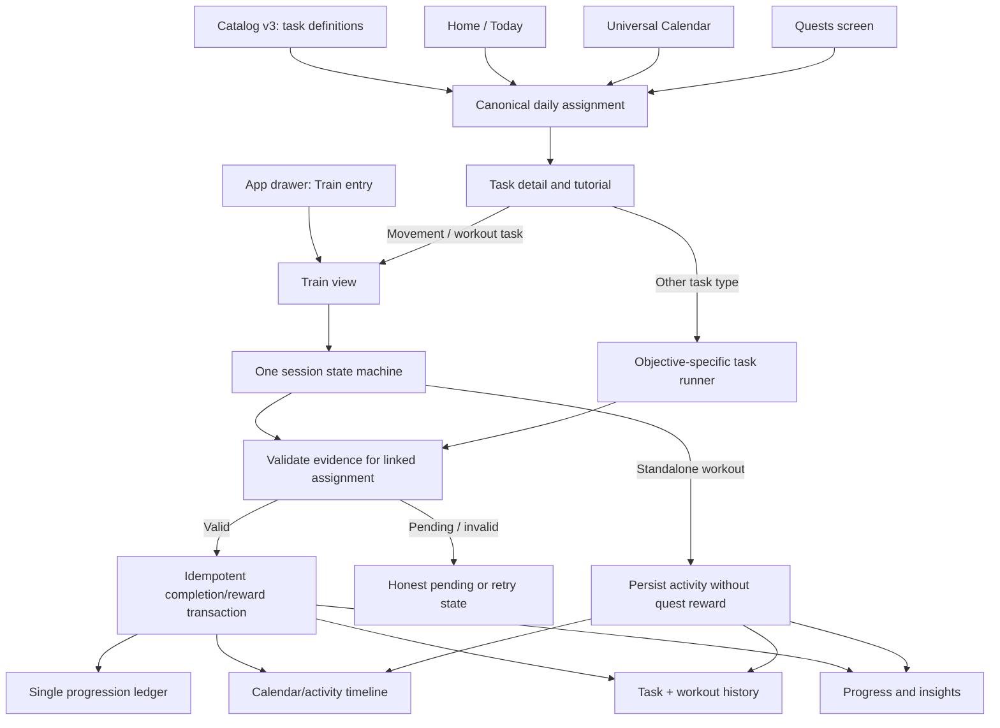

# THRIVEFOLD — COMPACT MASTER REPAIR & COMPLETION PROMPT v3

**Execution mode: Continue the existing app in place. Implement, connect, test, commit and verify.**
**Navigation correction:** Train is part of the unified Quests & Activities system. It has a dedicated Train screen and an app-drawer entry, but must not become a disconnected subsystem or a duplicate task/reward engine.  
**Authoritative specs:** `propmt.md` (if that misspelled filename exists), `thrivefold_ultimate_master_build_prompt_v2.md`, this prompt, `AGENTS.md`, and the current repository.  
**Product:** Existing women's-health app + universal health/calendar/routines + men's health + optional LGBTQ+ wellbeing + quests/games/workouts + local-first AI + private communities/correspondence.  
**Backend default:** Existing Supabase/Postgres integration; no competing Firebase source of truth.  
**Rule:** Inspect current code and Git history first. Preserve completed work and user data. Do not ask me to repeat requirements already in the files.

## 1. Mission and non-negotiables

Act as the senior product architect and implementer. Finish the real application, not another plan or set of mock screens. Inspect `propmt.md` (including its exact spelling), the full master prompt, `AGENTS.md`, existing docs, current routes, stores, migrations, `package.json`, tests, uncommitted changes and recent commits before editing. Treat the **current repository plus the master spec** as the source of truth; use the work log below as evidence to verify, not as proof that code still works.

- Preserve the existing women's-health experience, brand, working screens, cycle history, historical data, design tokens, bottom tabs and previous working **Today / “Cycle and calendar”** flow. Make additive, reversible changes. Never replace a working calendar/dashboard with a new tab or redesign that removes functionality.
- **TRAIN IS A DEDICATED SCREEN WITHIN THE UNIFIED QUESTS & ACTIVITIES SYSTEM.** It is not a separate product, independent task engine, duplicate catalog, separate reward economy or disconnected workout app. Build a complete `/train` experience and link it from the app drawer, Quests, Home/Today, Calendar, task details and Progress. The established bottom tabs must remain as proven by Git history; do not invent a new Train bottom tab just to make the screen reachable. The Train screen is required, but all records, task assignment, completion, history, calendar links and rewards must use the same canonical Quest/Activity services.
- Keep **Universal Calendar + Health Data**. Do not remove women's cycle tracking. A man must not see a women's cycle engine/card/settings merely because it is globally hard-coded. Render cycle-specific UI only when the selected profile/health experience enables it; the shared calendar remains available to everyone with their relevant events.
- Use **catalog v3 only** for quest/task definitions. Do not resurrect v1/v2 catalogs or invent duplicate task data in screens. Preserve real existing records and valid progression.
- One task, game, routine, workout, meal log, calendar event and progress system must connect end to end. No dead buttons, decorative roadmap, fabricated history, fake metrics, fake people, pretend model loading or stubbed “success.”
- Use the package manager and versions already established by the repository. No blind dependency upgrades, destructive resets, overwritten uncommitted work or production DB resets.
- Work in coherent milestones and **commit after each green milestone**. Inspect `git status` first; do not include another agent's unrelated edits. Report actual commit hashes, tests and remaining blockers. Never say a device screen was visually verified if it was not opened and checked.
- If a real external credential/provider/device blocks a feature, finish its UI, contracts, safe offline behavior and tests; state the exact blocker. Do not fake the integration.

## 2. Required initial audit and traceability

1. Inspect current repository structure, `AGENTS.md`, `propmt.md`, `thrivefold_ultimate_master_build_prompt_v2.md`, `TRACEABILITY.md`, product/architecture/route docs, Git status/history, Expo SDK/RN versions, router, stores, database schema, RLS, connected-app integrations, calendar/cycle engine, v3 catalog and validation report, YouTube references, camera/MediaPipe modules, AI providers, food log and tests.
2. Use `git log`/diff to recover the **previous working Today tab/calendar flow** if it was accidentally replaced. Restore the prior behavior and labels, then integrate new features inside that established space. Do not guess the old UI if the history can show it.
3. Create/update a concise `docs/requirements/TRACEABILITY.md`: requirement → route/screen → domain/store/API/table/native module → test → status. Mark `implemented`, `verified`, `partial`, `blocked` or `not started` truthfully.
4. Before completion, scan the whole app for runtime crashes, infinite renders, stale selectors, dead controls, bad route links, hardcoded sample values, inconsistent themes, unsafe-area problems and missing loading/empty/error/offline/permission-denied states.

## 3. Correct information architecture and Expo Router

Preserve established routes and naming where possible; do not restructure only for aesthetics. Every visible destination must resolve to a real route, and direct/deep links must enforce the same authorization as UI navigation.

Inspect and document actual route files, then ensure these **route capabilities** exist and are connected (names can follow the existing repo):

- Auth: intro/onboarding, sign-in, sign-up, email verification/recovery, session restoration, guest/local mode.
- Main tabs: preserve existing Home, Today/Cycle & Calendar, central Check-in, Progress/Roadmap, and You/Profile tabs/labels/order from the established app. Do not reorder or remove established tabs. Train is a dedicated route within the same Quests & Activities system, reachable from the app drawer and contextual links; it is not automatically a bottom tab.
- Calendar: universal calendar, selected-date details, event create/edit, agenda, cycle history and date-range views.
- Health: selected health hub, symptoms/history, sleep, mood/check-in, nutrition/food, medications, exercise/workouts, connected apps, journal, patterns/insights.
- Quests & Activities (one connected domain): daily assignments, task detail/tutorial, task runner, objective-specific verification, skip/replacement, games/arcade, workout/training tasks, results and rewards.
- Train view: a dedicated route into that same domain showing eligible training quests, planned sessions, exercise library, saved/recent sessions, workout plans, tutorial/video player, active camera/rep coach, pause/resume/rest, set completion, session summary/history and safe recommendations. It must consume the same task/catalog/assignment/session services—never a second task list, completion engine, progress store or reward ledger. When training is launched from a quest, it resumes/completes that exact assignment; it must not create a duplicate quest or session.
- Progress: real v3 level roadmap/chapter checkpoints, skills, achievements, earned XP/points/diamonds, unlocks and history.
- You/settings: selected product/persona, preferences, privacy/on-device memory, connected apps, notifications, account/data controls and the correct gender/health-specific settings.
- Optional, separately gated community/correspondence and organization routes from the master spec. Do not show them to an ineligible user; direct route/API access must also deny access.

**No stray route or global hardcoded card may show cycle tracking for a male profile.** The selected health experience—not a simplistic gender check repeated through components—must drive configuration, accessible content, modules and theme. Health needs remain user-controlled and must not infer anatomy, identity or preferences solely from a display name.

### App drawer — required navigation surface

Implement a real app drawer/side navigation panel using the repository's established navigation and the installed Expo Router-compatible approach. Do not create a drawer that contains only placeholders or duplicates every bottom tab without hierarchy.

- Add an accessible menu button to the shared main header where appropriate; support opening/closing, backdrop tap, Android hardware/back gesture, safe areas, screen readers, keyboard/focus, reduced motion and predictable restoration of the previous screen.
- Use grouped sections with concise labels and consistent icons: **Your day** (Home/Today, Universal Calendar & Routine, Check-in); **Quests & Activities** (Daily Quests, Train, Games, task history, workout plans/library/session history); **Progress** (Roadmap, skills, achievements, insights); **Health** (applicable health hub, cycle/period tracking only when enabled, Nutrition/Meals, Medications, Connected Apps); **Community** (eligible and opted-in Circles, Organizations, Letters/Correspondence); **Preferences** (profile/experience, appearance, accessibility, notifications, privacy/on-device AI, account/help). Treat Train as a focused view of the same activity engine, not a separate app or duplicate task system.
- Avoid confusing duplication: bottom tabs remain the primary frequent destinations; the drawer exposes secondary navigation, including **Quests**, **Train**, Games, workout history and plans. Multiple entry points must navigate to the same canonical route/state; do not create duplicate screens or duplicate task/session records.
- Render menu entries from route metadata plus current profile/feature eligibility. Do not infer gender, health needs or community eligibility from display name. Hide features that the user cannot discover, but enforce access in route guards and server/RLS policy too.
- Preserve scroll position/context where practical. Show active route state and selected product experience. When the user changes experience/theme, update the drawer theme without deleting history or navigating into an incompatible health screen.
- The drawer must include real navigation for Calendar & Routine, Train, workout history, Food & Macros, Connected Apps, Settings and all existing core areas. A menu item may not be a dead button, external placeholder, or route that crashes.
- Add route smoke tests for every drawer item, authorization tests for gated entries, and a UI test for open → navigate → back/close behavior.

### Train screen — a connected view inside Quests & Activities

Implement a dedicated **Train** route/screen and include it in the app drawer. Preserve the established bottom-tab bar from Git history. The key rule is: **Train is a focused screen within the same Quests & Activities system, not a disconnected feature or another bottom-tab mandate.**

Train is the workout-focused view over the same canonical activity engine and records. A daily Movement quest may open the Train route as its task runner. A user may also start a standalone planned workout from Train; that activity still writes to the shared history/calendar/insights, but it receives quest rewards only when it is linked to a qualifying assignment and passes that assignment's own verification rules. Never create duplicate assignments, double sessions, duplicate calendar entries or duplicate rewards.

- Header: clear **Train** title, selected health experience, concise status and a working route to training history/settings.
- Continue training: resume an eligible in-progress session without creating a duplicate session.
- Today's plan: show the actual scheduled session or an honest empty/rest state; never invent a workout.
- Plan catalog: appropriate home/no-equipment, desk mobility, beginner, strength-maintenance, recovery, and any existing gym plans, filtered by the user's actual goals, ability, constraints and selected health experience.
- Exercise library: searchable/filterable movements with beginner/advanced modifications, instructions, safety notes, required equipment, target areas and verified tutorial references when available.
- Exercise detail: purpose, setup, technique steps, breathing cues, common mistakes, modifications, stop conditions and a functional embedded video or explicitly labelled fallback when no verified video exists.
- Session runner: warm-up, exercise order, sets/reps/duration, rest timer, pause/resume/cancel confirmation, manual completion, supported camera rep tracking, spoken counts and optional hands-free controls.
- Completion: summary of actual reps/sets/duration/RPE/pain flag, source of verification (manual vs camera), save session exactly once, and expose appropriate next actions.
- History/insights: show real saved sessions and trends; no fake energy/recovery/sleep metrics or made-up history.
- Integration: workout sessions, task assignments and activity events use one canonical ID/linkage model. Completing a workout writes one canonical session, updates universal calendar/activity history and insights, and satisfies the linked Movement quest only when that exact assignment's objective/verifier passes. A quest-launched workout must continue the same assignment/session. Standalone training is logged without inventing a quest. Do not double-count reps, sessions, calendar entries or points/XP/diamonds.
- Provide first-run, no-plan, rest-day, camera-denied, unsupported-device, no-video, offline, save-failed and unfinished-session states. Avoid body-structure assumptions; personalization can use goals and movement constraints without a body scan.
- A user's self-reported session (for example, 10 reps already done tonight) can be logged honestly as manual/self-reported. Do not label it camera-verified without actual camera evidence.

### Connected quest/activity flow — mandatory architecture contract

Every entry point must lead into one canonical lifecycle. Do not create disconnected Home tasks, Quest cards, Train plans or workout sessions.

Rules: (1) a quest-started session carries the exact `assignmentId` and `taskDefinitionVersion`; (2) resuming returns to the same session; (3) one completion event is idempotent; (4) task verification, not entering Train or pressing Finish alone, decides whether a linked quest is complete; (5) standalone workout logs never mint quest rewards by themselves; (6) video IDs are associated with canonical task/exercise IDs; (7) calendar rows deep-link to the same canonical task/session; (8) XP, points and diamonds are awarded once by the authoritative progression service. Test every edge in this flow.

## 4. Universal Calendar + Health Data — restore and complete

The calendar is a core navigation surface and must be easy to find from the existing Today/Cycle-and-calendar area, Home shortcut and You → Calendar & Routine. One consistent calendar service/store must feed all views and tasks; do not implement separate conflicting calendars for Home, workouts, quests and health.

Required views: **Day, Week, Month, Year, Agenda, Cycle History and selected date range**, with consistent selected date and navigation. Support create/edit/reschedule/cancel/delete, recurrence/overrides, filters, search, reminders, local time zone, month/year boundaries, leap years and history navigation.

Calendar entries can include real saved: cycle/period events where enabled, symptoms, health check-ins, tasks/quests, workout plans/sessions, rest/recovery plans, appointments, medication reminders, meals, birthdays/family birthdays, anniversaries, work/study deadlines, travel, holidays and financial reminders. Display only actual saved/configured data. Never seed fake birthdays, anniversaries, medications, daily activities or events to make the calendar look populated. A quest may appear in the calendar only from its real persisted assignment; selecting it opens the real task.

### Women's cycle engine

Preserve all current cycle functionality and records. Support period start/end, ongoing bleeding, backdating/correction, spotting, flow, symptoms, pain, mood, energy, notes, cycle history and estimates. Use real logged periods; **never fabricate a period, default 28-day cycle, day-14 ovulation or prediction without adequate history**. Clearly distinguish observations from uncertain estimates. Model menstrual and follicular overlap correctly; estimated ovulation/fertile windows are not contraception. Handle irregular/unknown cycles, user-recorded PCOS/PCOD, contraception, pregnancy, postpartum/breastfeeding and perimenopause/menopause contexts without inappropriate forecasts. Preserve historical data when tracking context changes.

### User/profile-aware calendar

- Women's profile with cycle tracking enabled: show cycle data and cycle history in the universal calendar.
- Men's profile: show relevant generic health, routines, workouts, meals and reminders; no cycle engine/settings/cards unless the user explicitly enabled a relevant tracking module and that module is appropriate.
- LGBTQ+ profile: show selected, relevant health modules; do not assume cycle data or medical needs from identity.
- A new user without cycle history sees “Log a period” / “No estimates yet,” never a made-up cycle phase.
- Use device-local calendar dates for daily tasks, streaks, reminders and check-ins (fix the prior UTC-midnight issue, including Asia/Kolkata before 05:30). Store timestamps consistently; derive local-day keys from the user's configured timezone.

## 5. Daily plans, tasks, quests, games, Train and roadmap — one connected system

Use catalog v3 exclusively. Audit the current v3 catalog/schema/validation report and wire actual task objects to every UI surface. Do not replace distinct activities with repetitive generic cards.

- Generate stable daily assignments once for the user's local date; app restart/foregrounding must not reroll rewards or change tasks unexpectedly.
- Daily quests must respect the catalog's families/categories, level and prerequisites, user goals, ability, available content, and safety. Goals chosen at onboarding must really influence recommendations.
- Each task opens a real detail/tutorial route with plain-language purpose, steps, duration, required equipment, accessibility/easier alternatives, safety notes, evidence method and applicable rewards. Add a short “How to do this” tutorial for confusing activities.
- Different task types have different completion/verification: timed session, step checklist, reps/minutes, quiz with trusted server-side answer key, reflection, meal log, camera-verified exercise or permitted self-report. Never give camera/AI verification to an activity whose evidence cannot be checked.
- Skipping gives no reward and must not erase other progress. Offer a distinct same-family/category replacement of similar configured reward when one exists. If none exists, say so. Prevent reroll, replay and double-claim exploits.
- Completing a real task updates its assignment, calendar, daily goal, quest progress, skill/XP/level, earned currency and activity history through one idempotent transaction or equivalent safe server workflow. Do not let an arcade game award a quest reward on its own.
- The v3 roadmap must reflect actual level/skill/chapter/checkpoint data and link every node to its real task, lesson or screen. No decorative/fictional phases. Fix any catalog progression dead-end documented in `DECISIONS_AND_CONFLICTS.md` without silently changing the catalog's source-of-truth rules.
- Progress, Home, Today, Calendar, Quests, Train, Games, workout history, Food and Insights must read shared persisted domain data, not separate mocked arrays. Train is a filtered/workflow-specific view over the shared quest/activity domain. Show meaningful completion states and next actions.

## 6. Workouts, exercise videos and camera coach

Finish the complete connected activity path: quest/plan selection → exercise detail → tutorial → safe warmup → active session → sets/reps/rest → finish → persisted session/history → calendar/insights/progress → exact linked quest verification/reward when applicable. The same path must work whether entered from Quests, Train, Home or Calendar. Support home/no-equipment, desk, gym/equipment, beginner, recovery/rest and ability-modified routines. Do not frame men's health as only bodybuilding; include mobility, recovery, sleep/stress and appropriate reproductive/urinary education. Do not claim Kegels cure all symptoms.

### Every applicable task/exercise needs a real tutorial

- Search and curate a real relevant YouTube video for every exercise and every video-capable quest where a clear, useful tutorial exists. Finish the current incomplete sweep (logs say roughly 54/55 exercises had checked videos while quest-level video coverage was still incomplete; verify actual current data rather than trusting those numbers).
- Create/complete a typed media registry with stable task/exercise ID, exact title, channel/creator, video ID/URL, verified availability date, relevance/category, language, duration where available, embed eligibility and reviewed status. Do not keep unverified search results as if they were vetted tutorial videos.
- Prefer reliable qualified instructors or reputable health/fitness organizations. Do not choose unrelated videos just to hit 100% coverage. If a suitable direct video cannot be validated, use an **in-app YouTube search experience** for that task and label it as search—not as a vetted video.
- Video playback must remain inside the app using a supported YouTube embed/player where permitted. Do not open the external YouTube app/browser by default, download/rehost YouTube content or hide unavailable/embed-restricted states. Follow current YouTube platform terms and show attribution. Use an in-app result/search fallback when embedding is not allowed or the video is unavailable.
- Every workout plan, exercise detail, camera coach, learning page and applicable quest links to its own relevant video or in-app search. Fix the existing demo/player that does not play, aspect ratio, playback controls, loading/errors, orientation, safe areas, fullscreen/back handling and playback-state coordination. Do not silently play irrelevant videos.

### Live camera, pose landmarks and rep tracking

- Audit and finish the existing camera/MediaPipe integration; verify native module registration, permissions, model packaging and actual runtime landmarks.
- Process frames efficiently on-device when supported. Fix lag, stale frame timing, landmark overlays/positions, target alignment, low-light/occlusion handling, confidence thresholds and dropped frames.
- Implement exercise-specific rep state machines (start → eccentric/approach → target threshold → return → count) with hysteresis/cooldown to prevent double counts. Do not count from arbitrary elapsed time or a briefly crossed landmark.
- Show the large current rep count, target, remaining reps, set/rest timer, clear position guide, correct/incorrect form feedback only when confidence is sufficient, and clear pause/resume/finish/cancel controls.
- Synchronize a restrained breathing animation and optional spoken count/coaching (“3 remaining”, etc.) with confirmed rep/session state. Avoid speaking every frame. TTS must be configurable, rate-limited and interruptible.
- On valid completion, show a completion screen, save the actual set/session, update the appropriate quest only after its completion policy passes, update calendar/activity history, and prevent duplicate rewards. Handle premature exits and app backgrounding safely.
- Provide optional opt-in hands-free voice controls and gesture controls **while the user has explicitly started the workout/coach**. Voice examples: pause, resume, repeat instruction, stop, next set, enable/disable speech. Camera/voice must not run covertly in the background or listen continuously outside the active session. Gesture controls must be documented, configurable and use confidence/debounce thresholds.
- Accessibility is essential: deaf/hard-of-hearing users need visible count, captions/visual cues and touch controls; blind/low-vision users need spoken instructions and screen-reader labels where feasible; every gesture/voice action has an accessible manual alternative. Don't require gestures to finish.
- If camera/MediaPipe is not available, offer manual/timed reps, sets and self-reported completion without falsely labeling it camera-verified.
- Include manual logging for a workout already done. Example: if the user reports completing 10 reps tonight, allow them to record 10 as **self-reported/manual**, with local date/time; do not present it as camera-verified or invent extra activity.

## 7. Meals, food photos and macros

Complete Food/Nutrition as a real part of the health, calendar and quest system:

- Capture or select a meal photo; default to local/private storage.
- Search/select foods (include useful common Indian foods/dishes), adjust serving/portion sizes and calculate calories, protein, carbs and fat from a documented nutrition dataset. Show source/approximation and totals; do not invent precision.
- Optional image-based food recognition may run only if a real local vision model or consented/configured cloud vision provider exists. Clearly disclose upload before a photo leaves the device. A photo alone must not magically produce macros if no image model exists.
- Manual food/portion selection must always work offline and be the fallback.
- Saved meals feed daily macro totals and evidence-backed nutrition insights. A meal-linked quest can complete only when its required food log is saved; don't award a meal quest from merely opening the camera.
- Calendar, Home, relevant nutrition quests, Food and Insights use the same saved meal record. Provide edit/delete and correct daily-date behavior.

## 8. Local AI, voice and personalization

Keep local-first AI honest and useful. Routine task selection, check-in classification, local retrieval/memory and suitable explanations must work without Gemini/cloud keys. Do not show fake “model loaded” status. If there is no actual local LLM bundled/installed/benchmark-tested, clearly label available functionality as deterministic local intelligence—not an LLM.

- Use the user's selected goals, completed task history, self-reported energy/stress/sleep, permitted health logs, accessibility and preferred difficulty to suggest a task, recovery/rest, tutorial or check-in.
- Local private memories are opt-in, editable, pausable, exportable and deletable. Do not automatically save every journal entry as permanent memory.
- Any multi-provider cloud AI proxy must use server-side keys, allowlists, schema validation, timeouts, quotas, cost caps, minimal approved context and explicit consent for sensitive data. Cloud AI must never determine permissions, health diagnosis, age, religion, eligibility, rewards or bans.
- Improve the existing recovery recommendation, local insights and patterns. Show evidence counts and “based on your logs” wording; do not claim causation or diagnosis from small datasets. Fix the existing Home wiring so recovery rules and insights actually run.
- Greetings and reminders use local time and selected language/preferences. Never infer religion, nationality or community from device locale/GPS. Cultural/festival reminders are based on optional user selection.

## 9. Login, onboarding, Home and universal UX repair

Fix the full flow: intro slider → sign-in/sign-up/guest → onboarding → daily check-in → Home/Today → task/tutorial → active exercise/video → completion → Calendar/Progress. Every return/back/skip path must work.

- Keep proper session persistence, validation, clear auth errors, loading/success states and account recovery.
- Remove preselected women's-health focus for users who have not selected it. Ensure a male profile does not see cycle engine in settings; allow the user to correct their selected experience under Personalize.
- Fix the Home greeting, using local time and actual profile/display name; avoid duplicated or culturally inappropriate automatic greetings.
- Restore collapsible headers/scroll behavior consistently. Handle status bar, navigation bar, safe-area insets, keyboard, modal sheet, back gestures, orientation and Android hardware back properly.
- Preserve bottom tabs exactly as established. The Today tab must keep the useful **Cycle and calendar** space containing Calendar, Forecast, Quests and Games, while universal calendar and tasks/plans/routines remain connected. Do not add Train tab.
- Keep Workouts accessible from Home tools and from relevant tasks without duplicating an entire task list on another tab.
- Replace fake empty-state stats with a helpful next action. Use one consistent design system with correct women/men/Pride theme variants; do not mix icons, wording or health modules from other variants.
- Explain difficult tasks with brief, optional interactive tutorials and plain language. Avoid over-animation, generated-feeling clutter, giant empty cards, fake badges and redundant dashboards.

## 10. Connected apps and crash/performance sweep

Fix the reported Connected Apps crashes and every other crashing route. The work log identified unstable selectors that returned a newly created empty array each render and caused infinite rerender loops; audit all store selectors and memoization, not just the one reported crash.

- Test first-run/no-health-data, male, female with/without cycle history, LGBTQ+, guest, signed-in, offline, permission-denied and integration-disconnected states.
- Connected Apps must show only real configured/available integrations; proper connect/disconnect/permission/error/empty states; no fake connected state or fake values. Never claim Apple Health/Samsung Health/Fitbit is connected if it is not.
- Remove render loops, unnecessary rerenders, blocking work on the JS thread, excessive camera frame processing, repeated catalog scans, and unbounded calendar recurrence generation.
- Use stable selectors, memoization where it actually helps, `FlatList`/virtualization for long lists, lazy-loaded media, image sizing/cache controls and measured performance improvements.
- Do not hide exceptions. Add useful safe error UI and diagnostic logs that exclude private health/social text.

## 11. Community, Slowly-style correspondence and social gating

Preserve the master spec's private communities, organization verification/invitations/roles, local/coarse location discovery, events, moderation, correspondence, stamps, delayed letters, inbox/outbox, profile/avatar, preferences, chip-only messages, daily intro limits, blocking/reporting and trial/entitlement rules.

- **No arbitrary text input in controlled social introductions.** Use curated message chips/cards and approved templates; no hidden free-text field.
- Preserve the requested seven-day free correspondence pathway and its daily introduction quota as a configurable rule for the specified eligible cohort; initial cohort access does not automatically grant community access.
- Keep all age boundaries as explicit, tested configuration. No minors in adult correspondence. If age-verification provider/backend is not configured, keep adult social disabled and clearly distinguish the blocker; never fake verification.
- Religion/food/cultural preferences must not be secretly inferred. Any lawful compatibility preference must be voluntarily supplied and purpose-disclosed. Do not implement automatic exclusion, shadow banning or deletion of people solely for religion/caste/nationality/political affiliation/sexual orientation. Preserve disputed founder requests in `FOUNDER_POLICY_REQUESTS.md` for review rather than silently implementing discriminatory rules. Use evidence-based rules for harassment, coercion, spam, MLM scams, hate, manipulation and abuse.
- A person may see only communities they are invited to or allowed to discover. Enforce in RLS/server APIs, not UI only. Organizations must be verified, and their admins cannot see personal health logs or local AI memory.
- Progressive disclosure may keep modules out of ineligible users' navigation until clear, stated requirements are met. Do not disguise actual functionality from participants, app stores, regulators or payment providers. A disclosed feature can still be discreet and private.
- Payment/credits never bypass consent, blocking, age rules, quotas or moderation. Do not charge or reward users for pushing sexual content or coercive engagement.

## 12. Data integrity, universal links and shared state

Choose one source of truth for each domain and connect it through typed domain services. Avoid duplicated independent stores for the same calendar, tasks, workout stats, macro totals, XP or profile.

Required links:

- Workout finished → session history + calendar/activity + qualifying movement quest + valid progression ledger.
- Meal saved → nutrition log + macro totals + calendar + qualifying nutrition quest + insights.
- Daily check-in saved → local-day record + relevant suggestion + Home summary + trend history.
- Period logged/edited → cycle engine + calendar/cycle history + correct future estimate recalculation.
- Quest completed/replaced → persisted assignment + roadmap/progress + ledger + calendar, without double claim.
- User profile/experience changed → appropriate theme/navigation/health modules and preferences; never erase historical data.
- Connected provider sync → permissions and origin metadata, conflict handling and an honest sync status.

All writes must be idempotent where retries can occur. Use local-date keys and timezone-aware timestamps; preserve offline edits and reconcile conflicts rather than losing records. No sample users/events/medications/cycle records in production.

## 13. Suggested project/file tracks — adapt to actual repo

Do not create duplicate architecture if the project already has equivalent modules. Map each track to current files and keep one canonical implementation.

1. **Navigation/theme/drawer:** Expo Router layouts, existing tabs, guards, accessible app drawer, active-route state, safe-area/status bars, profile-aware themes.
2. **Calendar/health:** `calendar` domain, event store/service, cycle engine, local-day/time-zone utilities, date-range selectors and universal views.
3. **Task/game/progression:** v3 catalog adapter, daily assignment engine, task detail/runner, verification, ledger, roadmap/unlocks.
3. **Unified Quests & Activities / Train / camera:** one v3 task catalog and assignment lifecycle; dedicated Train screen as a view over that same engine; workout plans and sessions linked to quest assignment IDs; exercise library; `YouTubePlayer`; tutorial registry; camera/MediaPipe native bridge; rep state machine; TTS/gesture controllers. No separate Train task or reward system.
5. **Food/macros:** local food catalog, meal photo/local storage, portions/calculations, nutrition quest link, insights.
6. **AI/privacy:** local classifier, retrieval/memory, model capability status, optional server-side AI router, privacy settings.
7. **Integrations:** Connected Apps state/permissions and provider sync.
8. **Community/correspondence:** eligibility, Supabase RLS, letter delivery, chip templates, organization workflows and moderation.
9. **Reliability:** crash sweep, performance measurements, accessibility, integration/regression tests, release/install verification.

For routes, preserve actual filenames but document a map similar to: `(auth)/*`; `(tabs)/home`, `(tabs)/today`, `(tabs)/check-in`, `(tabs)/progress`, `(tabs)/you`; and feature routes for `calendar`, `cycle`, `tasks`, `games`, `train`, `workouts`, `exercise/[id]`, `workouts/session/[id]`, `food`, `insights`, `connected-apps`, and any gated community/correspondence routes. The app drawer must link to `train` and other secondary destinations. Keep Train as a dedicated screen/route inside the unified Quests & Activities flow, linked from the drawer and task/context entry points. Do not create a separate Train data/reward engine or add a new bottom tab unless established source-of-truth evidence requires it.

## 14. Execution order and commits

Work through these tracks in dependency order, but continue beyond each phase; do not stop after a plan/report:

**P0 — Protect and recover:** Git status/backups; read docs; trace current regressions; restore prior Today/calendar/tab flow; prevent male cycle-engine leakage; fix known render-loop crashes.

**P1 — Date/data backbone:** one universal calendar/date model; cycle-history correctness; local-day timezone fixes; tasks/plans/routines/health events aligned; no fake defaults.

**P2 — Connected daily loop:** profile-aware Home + check-in + v3 quest assignment + task detail/tutorial + skip/replace + completion + roadmap/ledger + calendar.

**P3 — Unified Quests & Activities + Train + media:** wire Train as a focused screen in the same v3 quest/task engine; complete drawer entry; connect plans/exercises/sessions/tutorials, real video registry/in-app player, live landmarks/timing/rep counting, speech/gestures, history, calendar and qualifying quest verification without duplicates.

**P4 — Food and integrations:** meal photos/manual foods/macros; nutrition quest; connected apps crash/permission/sync states.

**P5 — UX/performance sweep:** login, intro, onboarding, greeting, collapsible headers, tab flows, every button/link, safe areas, slow lists, animations, offline/error states.

**P6 — Backend/security and remaining scoped modules:** verify configured Supabase/RLS/migrations and safely finish actual in-scope services; do not fake unavailable external providers.

**P7 — Full verification and release:** tests, Android build, install, route walkthrough, crash/log review, documentation and final report.

Commit after every meaningful green milestone, using focused commit messages. Before each commit check `git diff`, `git status`, test results and that no unrelated agent edits are staged. Do not revert others' valid work. If commits are restricted by repository policy, report that precisely.

## 15. Definition of done — all must be evidenced

- [ ] Existing women's-health screens, cycle data and previous Today/calendar flow preserved; established bottom tabs are not arbitrarily changed. A complete Train screen exists, is reachable from the app drawer, Quests and relevant contextual links, and works as one connected view of the shared activity/quest system.
- [ ] App drawer is implemented, accessible, grouped, profile/eligibility-aware and every item navigates to a real working route; gated destinations are also protected server-side.
- [ ] Universal calendar has required views and real events/tasks/plans/routines; day/time-zone edge cases tested.
- [ ] Men see men's/generic health UI—not a hardcoded women's cycle engine; cycle remains available for appropriate opted-in experience.
- [ ] Check-in, Home, tasks, games, Train, workouts, food, calendar, roadmap, history and progression share real persisted data; Train is a view/workflow in the same Quest & Activity engine, with no duplicate task catalog, assignment state, session history or reward logic.
- [ ] Quest v3 is the sole catalog; stable daily tasks; same-family replacement; objective verification; no duplicate rewards.
- [ ] Roadmap nodes reflect real v3 levels/chapter checkpoints and link to genuine destinations.
- [ ] Every applicable exercise and video-capable task has a relevant verified YouTube reference or a clearly marked in-app search fallback; player works inside the app where permitted.
- [ ] Camera coach tracks real supported landmarks; reps are counted once with exercise-specific thresholds; breathing/TTS/voice/gestures are synchronized, optional and accessible.
- [ ] A manually reported completed session (e.g., 10 reps tonight) can be recorded as self-reported, never falsely camera-verified.
- [ ] Food photos stay local by default; portions/macros work; image-AI claims are honest; nutrition quest linkage works.
- [ ] Connected Apps, sign-in, onboarding, calendar, roadmap and all main routes survive first-run, missing-data, offline and denied-permission states.
- [ ] No invented profiles, appointments, medications, cycles, metrics, video links or “connected” states.
- [ ] RLS/server authorization, user isolation, blocks, credits and entitlements have relevant tests.
- [ ] Typecheck, lint, unit tests, DB/security tests and production build pass; build installed and core routes visually checked if device access permits.
- [ ] `TRACEABILITY.md` marks each item honestly; known blockers have clear reasons and safe behavior.
- [ ] All milestones have focused commits, and final response lists commit hashes, changed areas, test/build evidence, device-verification scope and genuinely remaining blockers.

## 16. Final operating instruction

Be decisive and systematic. Fix the causes, not the symptoms. Do not ask me to repeat this scope. Do not change the product navigation or remove working capabilities just to make a new design simpler. Do not misread Train as a standalone subsystem. Train is a required dedicated screen within the shared Quests & Activities engine, and the app drawer is also required. Every route must connect to the same canonical assignment, session, calendar and reward records. Don't spend the entire session reading files or writing another plan: inspect enough to act safely, then implement, test, commit and verify the working end-to-end flows. If a feature already works, preserve it and prove it still works. If an item cannot be completed due to missing credentials, unavailable hardware, vendor policy or external approval, finish the safely implementable portion, record the blocker precisely and keep the rest of the app functioning.

## Navigation and domain correction (v3)

**Do not make Train independent from Quests.** Train is a dedicated UI route for workout-related tasks and standalone workouts, but it uses the same v3 catalog, task definitions, assignment lifecycle, evidence policy, activity records, calendar integration, history, insights and authoritative reward ledger as the rest of the app. The drawer is a navigation surface into these same routes/services—not a second app. Quests can launch Train; Train can resume the exact quest assignment; Calendar can open the exact assignment or session; completed evidence flows back to Quest, Progress and History exactly once. All other app domains must follow the same single-source-of-truth principle.
